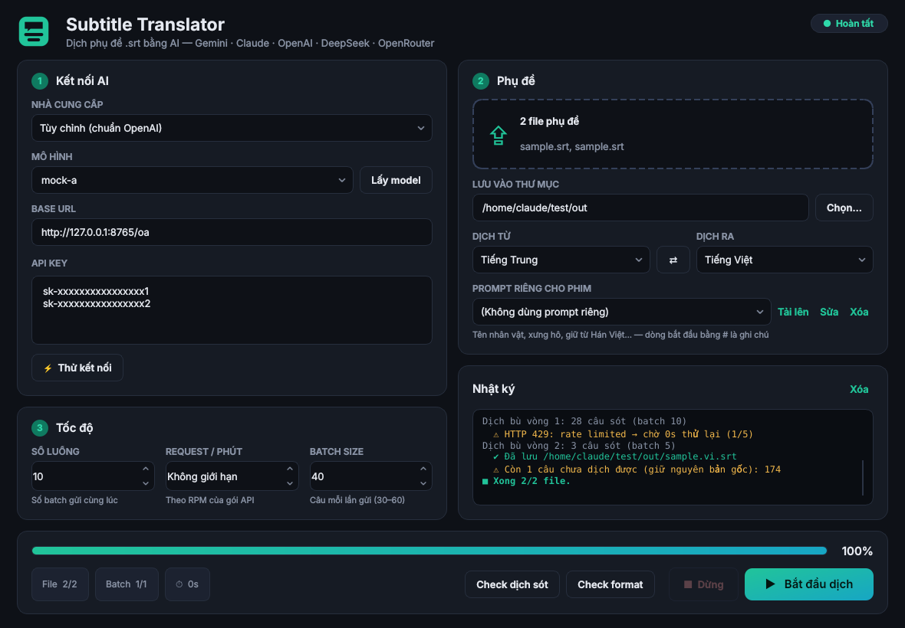

# Subtitle Translator

App desktop dịch phụ đề `.srt` bằng AI (Gemini, Vertex AI, Claude, OpenAI/Codex, DeepSeek, OpenRouter hoặc bất kỳ API nào theo chuẩn OpenAI). Dịch theo batch, chạy nhiều luồng song song, tự thử lại khi bị giới hạn tốc độ và tự dịch bù câu sót.

## Chạy

**Cách 1: chạy bằng Python (Windows)**

1. Cài Python 3.10 trở lên (khi cài nhớ tick "Add Python to PATH").
2. Bấm đúp `run.bat`.

**Cách 2: đóng gói thành file .exe**

Bấm đúp `build_exe.bat`. File chạy sẽ nằm ở `dist\SubtitleTranslator.exe`. Có thể copy file này đi bất kỳ đâu. Cấu hình và prompt được lưu trong thư mục `data\` nằm cạnh file exe.

## Tìm & tải phim (Bilibili, Douyin, Tây Qua, Weibo, Tiểu Hồng Thư, AcFun)

Bấm **1 · Tìm & tải phim** ở đầu cửa sổ. Không cần tài khoản.

**Chọn nguồn** ở ô đầu tiên:
- **Bilibili:** tìm và tải ngay trong app (các bước bên dưới).
- **Douyin (抖音), Tây Qua (西瓜视频), Weibo, Tiểu Hồng Thư (小红书), AcFun:** gõ từ khóa rồi bấm **Mở trang tìm**. App mở trang tìm kiếm của trang đó trên trình duyệt (phần tìm kiếm của các trang này chặn công cụ tự động). Bạn chọn phim, chép link hoặc cả đoạn chữ chia sẻ trong app, rồi dán vào ô **Dán link…** và bấm **Tải link này**. Link rút gọn (`v.douyin.com`, `xhslink.com`) được tự mở thành link đầy đủ. Video được lưu vào thư mục con mang tên trang.
- Douyin hay đòi cookie: nếu báo lỗi cookie, chọn trình duyệt ở mục **Cookie trình duyệt** (nên dùng Firefox, vì Chrome bản mới khóa cookie) rồi tải lại.
- Không hỗ trợ YouTube và các trang phim VIP có mã hóa (Youku, iQiyi, Tencent Video, Mango TV, Hồng Quả).

Với Bilibili:

1. Gõ từ khóa tiếng Trung, ví dụ `仙侠短剧`, hoặc bấm một gợi ý có sẵn. Nếu chỉ biết tiếng Việt thì gõ tiếng Việt (ví dụ "phim tu tiên ngắn") rồi bấm **VI→中**: AI sẽ đổi sang từ khóa tiếng Trung và tìm luôn.
2. Lọc theo **sắp xếp** (liên quan nhất, xem nhiều, mới đăng…) và **thời lượng**. Bấm Trang trước / Trang sau để xem thêm (tối đa 50 trang, mỗi trang 20 video).
3. Tick **Dịch tiêu đề sang tiếng Việt** để AI dịch tiêu đề. Ô này dùng nhà cung cấp AI đã cài ở tab Dịch phụ đề.
4. **Dán link để tải luôn:** dán vào ô "Hoặc dán link…" link video, link chia sẻ `b23.tv` trong app Bilibili, mã `BV…` hoặc `av…`, rồi bấm **Tải link này**. Link có `?p=3` sẽ tải đúng phần 3.
5. Bấm **⬇ Tải** ở video muốn tải. Video nhiều tập (P1, P2… hoặc tuyển tập) sẽ hiện hộp thoại để chọn tập. Các tập của một bộ phim được lưu chung vào một thư mục riêng.
6. Hàng chờ bên phải tải lần lượt từng phim, có tốc độ và thời gian còn lại. File lưu thành `.mp4`, tên file là tên đang hiển thị trong app. Có thể tick **Tải kèm ảnh bìa**, hoặc chọn chất lượng **Chỉ âm thanh (.m4a)**.
7. Phim nào lỗi sẽ có nút **📋 Sao chép lỗi**; bấm chuột phải vào dòng đó còn có thêm "Sao chép link video".

Lưu ý:
- Không cần đăng nhập vẫn tải được tới **1080p**: app gửi kèm tham số `try_look=1`, chế độ "xem thử" của trình phát Bilibili. Các mức 1080P+, 4K và 60fps chỉ dành cho tài khoản VIP (大会员).
- Cách tải: app lấy thẳng luồng hình (ưu tiên H.264 để CapCut mở được) và luồng tiếng qua API phát video của Bilibili, dùng cookie khách của app, rồi ghép lại bằng ffmpeg mà không nén lại. Nếu cách này lỗi, app tự thử `yt-dlp`. `run.bat` tự cập nhật `yt-dlp` mỗi lần chạy.
- Tải dở mà bấm Dừng thì file `.part` được giữ lại; lần sau tải tiếp từ chỗ dừng.
- Chỉ dùng phim tải về đúng với quyền của người đăng. Khi đăng lại phim, bạn tự chịu trách nhiệm về bản quyền.

## Dịch phụ đề

1. **Nhà cung cấp:** chọn nơi bạn có API key. Dán key vào ô API Key; có nhiều key thì mỗi dòng một key, app sẽ xoay vòng giữa các key.
   **Dùng nhiều nhà cung cấp cùng lúc:** ở mỗi nhà cung cấp muốn dùng, nhập key, chọn model rồi tick ô **Dùng nhà cung cấp này khi dịch**. Dòng tóm tắt ngay bên dưới cho biết lúc dịch sẽ dùng những nguồn nào. App xoay vòng qua mọi key của mọi nhà cung cấp đã tick; key nào lỗi hẳn (sai key, hết tiền) sẽ bị loại và các nguồn còn lại dịch tiếp. Nếu không tick ô nào thì app chỉ dùng nhà cung cấp đang chọn.
2. **Mô hình:** bấm **Lấy model** để tải danh sách model thật của key đó, rồi chọn một model. Bấm **Thử kết nối** để kiểm tra.
3. **Phụ đề:** kéo thả một hoặc nhiều file `.srt` vào ô nét đứt (hoặc bấm vào ô đó để chọn), ví dụ cả bộ phim. **Output** để trống thì file dịch được lưu cạnh file gốc, tên dạng `ten-phim.vi.srt`.
4. **Số luồng / Request/phút / Batch size:**
   - Số luồng là số batch gửi cùng lúc.
   - Request/phút nên đặt bằng hoặc thấp hơn giới hạn RPM của gói API của bạn, để không bị lỗi 429.
   - Batch size từ 30 đến 60 câu là vừa. Batch quá lớn thì model dễ bỏ sót câu.
5. **Prompt:**
   - **Upload File Prompt** để nạp file `.txt` hướng dẫn riêng cho từng phim: tên nhân vật, xưng hô, giữ từ Hán Việt…
   - **Sửa prompt** để mở file prompt ra sửa; nếu chưa có thì app tạo file mẫu.
   - Dòng bắt đầu bằng `#` là ghi chú, app không gửi dòng đó cho AI.
6. Bấm **Dịch**. Bấm **Dừng** nếu muốn dừng giữa chừng.
7. **Check dịch sót:** so file gốc với file đã dịch, tìm câu trống, câu còn chữ Hán/Nhật/Hàn hoặc câu giống hệt bản gốc, rồi chỉ dịch lại những câu đó.
8. **Check format:** kiểm tra số thứ tự, timecode và dòng trống. Nếu có lỗi, app có thể tự sửa; file cũ được sao lưu thành `.bak`.

## Xem app đang làm gì

Dưới thanh % luôn có dòng trạng thái: đang ở bước nào (Tách tiếng, Nghe giọng, Dịch, Dịch bù, Lưu file), bao nhiêu việc đã xong hay đang gửi, và việc nào đang chờ AI trả lời bao lâu rồi.

Bấm **⤢ Phóng to** để thẻ tiến độ chiếm cả cửa sổ, với một bảng liệt kê từng batch hoặc từng đoạn nghe: câu số mấy, gửi cho nguồn nào, đang chạy, đang thử lại hay đã xong, mất bao lâu. Bấm **⤡ Thu nhỏ** để quay lại màn hình cài đặt và nhật ký. App nhớ chế độ bạn chọn cho lần mở sau.

## Tạo phụ đề từ video (nghe giọng bằng Vertex AI)

Dùng cho phim không có file phụ đề riêng, ví dụ phim Bilibili có chữ in cứng vào hình.

1. Bật Vertex AI (API key hoặc Service account JSON) và tick ô **Dùng nhà cung cấp này khi dịch**. Model nên dùng loại nghe được âm thanh, ví dụ `gemini-3.5-flash` hoặc `gemini-2.5-flash`.
2. Kéo thả **video** (`.mp4 .mkv .flv .mov .webm…`) hoặc file âm thanh vào ô Phụ đề.
3. Bấm **Bắt đầu dịch**. App tách tiếng, cắt thành các đoạn khoảng 2 phút (cắt ở chỗ im lặng), rồi cho Gemini nghe song song. Kết quả ghi ra `ten-video.zh.srt`, sau đó app dịch tiếp ra `ten-video.vi.srt`.
4. Tick **Video: chỉ tạo phụ đề gốc, không dịch** nếu chỉ muốn lấy phụ đề tiếng Trung.

Một số điều cần biết:
- Prompt riêng của phim (tên nhân vật, thuật ngữ) cũng được gửi kèm ở bước nghe, nên tên riêng ít bị nghe nhầm hơn.
- Nếu đã có `.zh.srt` thì lần chạy sau app dùng lại file đó, không nghe lại (không tốn tiền). Muốn nghe lại thì xóa file `.zh.srt`.
- Thời gian do AI ước lượng, có thể lệch một chút; nên xem lại trong CapCut.
- ffmpeg được cài kèm qua thư viện `imageio-ffmpeg`, không cần cài riêng.

## Lồng tiếng Việt (VieNeu-TTS, chạy trên máy, miễn phí)

Tab **3 · Lồng tiếng** biến video tiếng Trung thành video nói tiếng Việt:

1. **Tách giọng**: model UVR MDX-Net (tự tải ~65 MB lần đầu vào `data/models`) tách lời thoại khỏi nhạc nền và tiếng động.
2. **Nghe giọng**: Gemini/Vertex nghe phần giọng đã tách, ghi lại từng câu kèm người nói, giới tính, cảm xúc (`.zh.srt`). Nếu đã có `.zh.srt` cùng tên thì dùng luôn.
3. **Dịch lồng tiếng**: dịch ngắn gọn vừa thời lượng câu nói (khoảng 4–5 tiếng/giây).
4. **Nhân vật & giọng**: AI gom câu theo nhân vật, app tự chọn giọng VieNeu hợp giới tính. App **dừng ở đây** để bạn nghe thử, đổi giọng, sửa câu.
5. **Đọc giọng & trộn**: VieNeu-TTS đọc từng câu, câu dài được đọc nhanh lên (tối đa 1.35x), rồi trộn với nhạc nền (bỏ hẳn giọng gốc) hoặc giữ tiếng gốc vặn nhỏ kiểu thuyết minh.
6. Xuất `ten_video.long_tieng.mp4` và `ten_video.vi.dub.m4a`. Ở tab 4 chọn **Âm thanh: Tiếng lồng** để vừa in phụ đề vừa có giọng Việt.

Cài đặt: máy có card NVIDIA chạy `cai_long_tieng_gpu.bat` (PyTorch CUDA 12.8, hợp RTX 50-series); máy không có card chạy `cai_long_tieng_cpu.bat` (chậm hơn nhiều). Lần đầu đọc giọng, VieNeu tự tải model từ Hugging Face. Mọi file trung gian nằm trong thư mục `ten_video_long_tieng/` cạnh video; câu đã đọc được lưu lại nên sửa một câu chỉ đọc lại câu đó.

VieNeu-TTS dùng giấy phép Apache 2.0 nên dùng được cho kênh có kiếm tiền. App chỉ dùng giọng có sẵn của VieNeu, không nhái giọng diễn viên gốc.

## Xuất video Vietsub (in phụ đề vào video)

Bấm **2 · Xuất video Vietsub** ở đầu cửa sổ. Đây là chức năng riêng, tách khỏi phần dịch.

1. **Video & phụ đề:** kéo thả video vào. App tự tìm file `ten-video.vi.srt` cùng tên (trong thư mục video hoặc thư mục lưu của phần dịch); bạn cũng có thể tự chọn file `.srt` khác.
2. **Kiểu chữ:** chọn một kiểu có sẵn (Trắng viền đen, Vàng viền đen, Nền đen mờ, Trắng bóng mềm, Cổ trang vàng kim, Chữ to TikTok) rồi chỉnh tiếp: font, cỡ chữ, đậm/nghiêng, màu chữ, màu và độ dày viền, bóng đổ, nền hộp, vị trí trên/dưới, khoảng cách từ mép. Cỡ chữ và viền tính theo % chiều cao video, nên video 720p hay 1080p đều hiển thị giống nhau.
3. **Che chữ có sẵn trong video:** chọn **Làm mờ** hoặc **Hộp màu**, rồi chỉnh mép trên, chiều cao và phần chừa hai bên cho khớp với chữ Trung in sẵn. Khung nét đứt xanh trên ảnh xem trước là vùng sẽ bị che. Bấm **Đặt phụ đề vào giữa vùng che** để phụ đề Việt nằm đúng chỗ chữ Trung cũ.
4. **Xem trước:** kéo thanh thời gian hoặc bấm **Câu trước / Câu sau**. Mỗi lần đổi cài đặt, ảnh xem trước tự cập nhật sau khoảng nửa giây.
5. **Xuất video:** chọn nén bằng CPU (x264, máy nào cũng chạy) hoặc card NVIDIA (NVENC, nhanh hơn), chọn chất lượng, rồi bấm **Xuất video**. Kết quả mặc định là `ten-video.vietsub.mp4`, âm thanh được giữ nguyên.

Font: app liệt kê font trong Windows và trong thư mục `fonts` cạnh app. Thả thêm font kiểu CapCut vào `fonts`; nhớ chọn font có đủ dấu tiếng Việt. Khi xuất, app chép font đi kèm nên không phụ thuộc máy.

## Ghi chú

- **Vertex AI:** chọn mục "Vertex AI (API key)", dán API key lấy ở Google Cloud console, mục APIs & Services > Credentials (key của chế độ Express cũng dùng được). Vertex không có lệnh liệt kê model bằng API key, nên bạn tự gõ tên model, ví dụ `gemini-2.5-flash`. App tự xin tắt bộ lọc an toàn để cảnh đánh nhau không bị chặn nhầm; nếu tài khoản không cho phép thì app tự gửi lại với bộ lọc mặc định. 
- **Vertex AI bằng file service account (`vertex.json`):** chọn mục "Vertex AI (Service account JSON)", bấm **Chọn file JSON…** để chọn file (có nhiều file thì app xoay vòng). Project ID được tự đọc từ file, sửa lại được. Location mặc định là `global` (có nhiều model nhất, ít bị lỗi 429); nếu gặp lỗi 404 "model not found" ở một vùng cụ thể như `us-central1` thì đổi sang `global`. App tự đổi file thành token và tự làm mới khi token hết hạn sau 1 giờ. Ba ô này tương ứng với `VERTEX_AI_CREDENTIALS`, `VERTEX_AI_PROJECT_ID` và `VERTEX_AI_LOCATION` trong file `.env` cũ. Tài khoản service account cần có quyền **Vertex AI User**.
- Cursor không cung cấp API key để dùng ngoài app của họ, nên không có trong danh sách. Codex dùng API key của OpenAI.
- Mục **Tùy chỉnh (chuẩn OpenAI)** dùng cho bất kỳ dịch vụ nào có endpoint `/chat/completions`, ví dụ Groq, Together hay LM Studio chạy trên máy.
- API key được lưu dạng chữ thường trong `data/settings.json` trên máy bạn. File này đã nằm trong `.gitignore`, nên không bị đẩy lên git.

## Cấu trúc code

| File | Việc |
|---|---|
| `app/srt.py` | Đọc SRT (tự nhận UTF-8, UTF-16, GB18030, Big5…), ghi SRT, kiểm tra format |
| `app/providers.py` | Gọi API: lớp chung cho chuẩn OpenAI và lớp riêng cho Claude |
| `app/transcribe.py` | Tách tiếng bằng ffmpeg, cắt đoạn theo chỗ im lặng, cho Gemini trên Vertex nghe và chép lời |
| `app/translator.py` | Chia batch, chạy nhiều luồng, giới hạn RPM, thử lại, dịch bù |
| `app/bilibili.py` | Tìm kiếm Bilibili (cookie khách buvid3, WBI dự phòng), danh sách tập, tải bằng yt-dlp |
| `app/sources.py` | Danh sách trang được hỗ trợ, lấy link từ đoạn chữ chia sẻ, mở link rút gọn |
| `app/search_page.py` | Tab Tìm & tải phim |
| `app/gui.py` | Giao diện PySide6 (khung chính, trang Dịch phụ đề) |
| `app/render.py` | Xuất video: SRT → ASS (kiểu chữ), che chữ cứng (làm mờ / hộp), xem trước một khung hình, nén x264/NVENC |
| `app/render_page.py` | Trang Xuất video Vietsub |
| `app/theme.py` | Màu sắc, kiểu dáng (giao diện tối), icon app |
