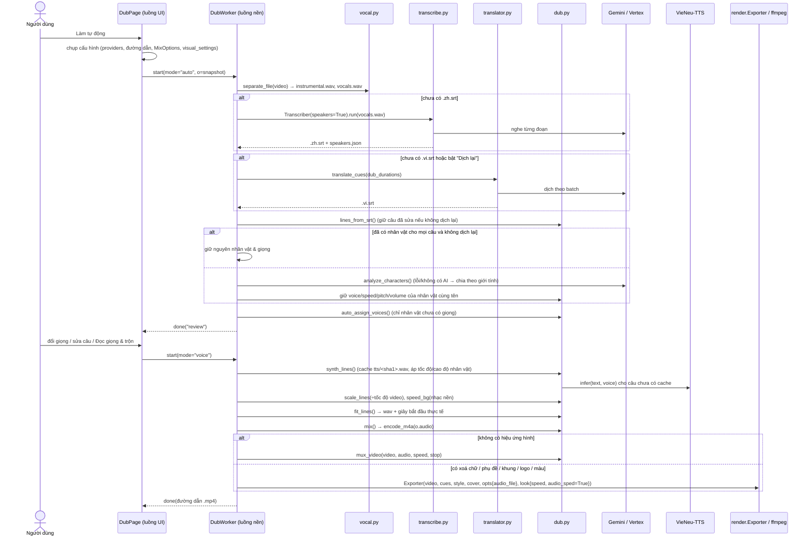

# Kiến trúc chức năng Lồng tiếng

Tài liệu bàn giao cho developer tiếp theo. Mô tả code tại thời điểm đợt ổn định 2026-11-25 (nhánh `main`).

## 1. Tổng quan

Tab **3 · Lồng tiếng** biến một video tiếng Trung thành video nói tiếng Việt:

```
video ─► tách giọng (MDX-Net) ─► nghe giọng (.zh.srt) ─► dịch kiểu lồng tiếng (.vi.srt)
      ─► nhân vật & giọng (dừng cho người dùng kiểm tra) ─► đọc từng câu (VieNeu-TTS)
      ─► khớp thời gian + trộn với nhạc nền (.m4a) ─► xuất video (.mp4)
```

Mọi thứ chạy trên máy người dùng. AI từ xa (Gemini/Vertex hoặc nhà cung cấp khác) chỉ dùng cho nghe giọng, dịch và nhận diện nhân vật. Có thể thay bằng Whisper/Qwen chạy trên máy (`app/hf_local.py`).

## 2. Trách nhiệm từng module

| Module | Trách nhiệm |
|---|---|
| `app/dub_page.py` | Giao diện tab Lồng tiếng (`DubPage`), luồng nền `DubWorker`, bảng Nhân vật / Câu thoại / Thư viện giọng, nghe thử, chụp cấu hình trước khi chạy. |
| `app/dub.py` | Lõi xử lý không phụ thuộc Qt: dữ liệu `Project/Character/Line`, nhận diện nhân vật qua AI, `TTSEngine` (VieNeu), cache câu đọc, đổi tốc độ/cao độ (`tempo`), khớp thời gian (`fit_lines`), trộn (`mix`), ghép video (`mux_video`). |
| `app/vocal.py` | Tách giọng nói / nhạc nền bằng UVR-MDX-NET-Inst_HQ_3 (onnxruntime, CUDA→CPU), đọc/ghi WAV qua ffmpeg. |
| `app/transcribe.py` | Nghe giọng thành phụ đề: Gemini/Vertex (kèm người nói, giới tính, cảm xúc) hoặc Whisper trên máy. Chia đoạn theo khoảng lặng, ghép lại không chồng thời gian. |
| `app/translator.py` | Dịch theo batch JSON; chế độ lồng tiếng thêm thời lượng `⟪2.4s⟫` vào từng câu để AI dịch vừa thời gian nói. |
| `app/render.py` | Bộ xuất hình (`Exporter`), xem trước 1 khung (`preview_frame`), dựng filter graph ffmpeg (`filter_graph`, `look_pre`, `look_post`, `audio_graph`), dữ liệu `Cover`, `Look`, `ExportOpts`, `SubStyle`. |
| `app/region_dialog.py` | Hộp thoại "Chỉnh sửa vùng hình ảnh": kéo chuột tạo/di chuyển/đổi cỡ vùng trên khung hình gốc (đã bỏ viền đen), thanh thời gian, xem kết quả thật bằng `preview_frame`. |
| `app/render_page.py` | Tab Xuất video Vietsub. Tab Lồng tiếng mượn `_style()`, `_look()`, `_opts()` của trang này (kiểu chữ, màu, phóng to, lật, nhạc nền, bộ mã hoá). |
| `app/gui.py` | Cửa sổ chính, điều hướng tab, tạo nhà cung cấp AI (`_make_translate_providers`), đồng bộ vùng che khi quay từ tab 4 về tab 3. |

## 3. Sequence diagram toàn bộ pipeline



## 4. Cấu trúc dữ liệu

### `dub.Project` (lưu ở `<thư mục dự án>/project.json`)
| Trường | Ý nghĩa |
|---|---|
| `video` | đường dẫn video gốc |
| `workdir` | thư mục dự án `<tên video>_long_tieng/` cạnh video |
| `characters: list[Character]` | danh sách nhân vật |
| `lines: list[Line]` | các câu thoại theo thời gian video gốc |

### `dub.Character`
`name`, `gender` ("nam"/"nữ"/""), `desc`, `voice` (id giọng VieNeu), `speed` (tốc độ đọc, giữ cao độ), `pitch` (nửa cung, không đổi tốc độ), `volume`.

### `dub.Line`
`index`, `start`, `end` (giây, **timeline video gốc**), `text` (lời Việt sẽ đọc), `src` (lời gốc), `speaker`, `emotion`, `gender_hint`.

### `dub.MixOptions`
`remove_original` (dùng nhạc nền đã tách hay tiếng gốc vặn nhỏ), `duck`, `voice_gain`, `bg_gain`, `max_speed` (đọc nhanh tối đa), `video_speed`.

### `render.Cover`
Vùng chữ cứng: `mode` (`none | erase | blur | box`), `y_pct`, `h_pct`, `x_pct` (**lề đối xứng hai bên**), `blur`, `box_color`, `box_opacity`. Toạ độ tính theo % khung hình gốc.

### `render.Look`
Chỉnh kiểu CapCut: `speed`, `aspect`, `bg`, `zoom`, `flip`, `bright`, `contrast`, `sat`, `sharpen`, `logo`, `logo_pos`, `logo_size`, `logo_opacity`, `fade`, `music`, `music_vol`, `voice_vol`, `denoise`, `audio_sped` (tiếng đã khớp tốc độ sẵn → không `atempo` thêm).

### `render.EditRegion` (lưu trong `project.json` → `regions`, theo từng video)
`x_pct`, `y_pct`, `w_pct`, `h_pct` (% khung gốc, góc trên trái + kích thước), `mode` (`erase | blur | box`, mặc định `erase`), `blur`, `box_color`, `box_opacity`, `start`, `end` (giây trên timeline gốc, `end = 0` là tới hết), `enabled`. Khác `Cover`: `Cover.x_pct` là lề đối xứng của dải phụ đề, còn vùng thì có toạ độ tự do.

### `render.ExportOpts`
`encoder` (`x264 | nvenc`), `crf`, `preset`, `audio_copy`, `audio_file` (tiếng thay thế, vd tiếng lồng).

## 5. Cache và lưu dự án

```
video.mp4
video.vi.dub.m4a                  tiếng lồng ở 1x (tab Xuất video dùng được)
video.long_tieng.mp4              video kết quả
video.long_tieng.vi.srt           phụ đề Việt đã khớp tốc độ (chỉ khi tốc độ ≠ 1x)
video_long_tieng/
    project.json                  nhân vật, câu thoại, giọng, tốc độ, cao độ, âm lượng
    instrumental.wav, vocals.wav  kết quả tách giọng (có rồi thì không tách lại)
    video.zh.srt, video.vi.srt    phụ đề gốc / bản dịch lồng tiếng
    speakers.json                 người nói/giới tính/cảm xúc theo câu (từ Gemini)
    video.vi.dub.1.25x.m4a        tiếng lồng ở tốc độ khác 1x, mỗi tốc độ một file
    tts/<sha1>.wav                từng câu đã đọc
```

- **Khoá cache câu đọc**: `sha1("v3|voice|text_kèm_thẻ_cảm_xúc")`. Sửa chữ hoặc đổi giọng thì đọc lại. Đổi tốc độ/cao độ/âm lượng nhân vật thì **không** đọc lại: các thay đổi này áp sau khi lấy từ cache.
- "Tạo lại câu đã chọn" xoá đúng file cache của các câu đó rồi đọc lại.
- Chạy "Làm tự động" lần nữa mà không bật "Dịch lại": câu đã sửa tay được giữ (khớp theo `index` + lời gốc). Nhân vật cùng tên giữ giọng/tốc độ/cao độ/âm lượng. Nếu mọi câu đã có nhân vật thì không gọi AI nhận diện lại.
- Chế độ **Xuất video lồng tiếng** chỉ dùng file tiếng đã trộn ở đúng tốc độ hiện tại: không gọi AI, không gọi TTS.

## 6. Đồng bộ tốc độ video, âm thanh, phụ đề

Gọi tốc độ video là `s`.

1. `Line.start/end` luôn theo timeline gốc. Khi trộn, `scale_lines` tạo bản sao với `start/s`, `end/s`.
2. Nhạc nền được `speed_bg` đổi tốc độ bằng `atempo` (giữ cao độ). Giọng Việt **không** bị tua theo `s`: câu được đọc tự nhiên rồi mới khớp vào khoảng thời gian mới.
3. `fit_lines` (sắp theo thời gian):
   - câu dài hơn chỗ trống → đọc nhanh tới `max_speed`;
   - vẫn dài → câu sau được lùi tối đa 0,6 s;
   - vẫn dài → cắt đuôi kèm mờ dần 120 ms, ghi log số câu để người dùng sửa ngắn lại.

   Kết quả không bao giờ có hai câu chồng lên nhau.
4. Hình: `mux_video` dùng `setpts=PTS/s` (NVENC, lỗi thì x264). `Exporter` dùng `Look(speed=s, audio_sped=True)`: hình `setpts`, phụ đề `scale_cues`, tiếng lồng giữ nguyên.
5. Phụ đề Việt khớp tốc độ mới được ghi ra `video.long_tieng.vi.srt`.

## 7. Truyền cấu hình DubPage → DubWorker → Exporter

`DubWorker.__init__` chạy trên luồng UI và chụp mọi thứ vào `self.o`. Luồng nền chỉ đọc `self.o`, không chạm widget (kiểm thử T11 theo dõi điều này).

| Khoá `o` | Nguồn |
|---|---|
| `providers`, `prov_err` | `gui._make_translate_providers()`. Lỗi được giữ lại và chỉ báo khi bước nào thật sự cần AI. |
| `asr` | `cfg["asr"]` (Gemini hoặc id model Whisper) |
| `zh_srt` | `find_srt("zh")` (thư mục dự án, cạnh video, thư mục lưu) |
| `audio`, `video_out` | `dub_audio_path()` (theo tốc độ), `dub_video_path()` |
| `remove`, `retr`, `skip_review`, `export`, `hints` | các ô tuỳ chọn |
| `mix` | `MixOptions` |
| `vis` | `visual_settings()`: `None` (chỉ thay tiếng) hoặc `{cover, subs, look, style, opts}` |

`visual_settings()` lấy `Look/SubStyle/ExportOpts` từ tab Xuất video, rồi ghi đè `speed`, `audio_sped=True`, `aspect`, `logo`, `logo_pos` bằng giá trị của tab Lồng tiếng. `voice_vol` và `denoise` được đặt về mặc định. `opts.audio_file` trỏ tới tiếng lồng.

Đồng bộ vùng che giữa 2 tab: nút "Căn vùng chữ ở tab Xuất video →" đẩy vùng sang tab 4. Khi người dùng quay lại tab 3, `gui._go_page` gọi `pull_cover_from_render` để lấy vị trí đã căn.

## 8. Thứ tự filter ffmpeg (`render.filter_graph`)

```
[0:v]
 1. Cover      drawbox / boxblur+overlay / delogo   (trên khung hình GỐC)
 1b. Vùng      region_filters: mỗi vùng nhãn [rgN], enable='between(t,start,end)' theo thời gian gốc
 2. look_pre   setpts (tốc độ) → hflip → crop+scale (phóng to) → eq (sáng/tương phản/bão hoà) → unsharp
 3. phụ đề     ass=sub.ass (thời gian đã scale_cues theo tốc độ)
 4. look_post  khung 9:16/16:9/1:1/4:5 (nền mờ hoặc đen) → logo (overlay) → fade in/out
[v]
âm thanh: [0:a hoặc 1:a] → afftdn → atempo (bỏ khi audio_sped) → volume → afade → amix nhạc nền → [a]
```

Che chữ đứng **trước** phóng to/lật, để vùng đã căn không lệch khi đổi phóng to (kiểm thử T9b). `preview_frame` dùng cùng `filter_graph`, chỉ bỏ tốc độ và mờ dần vì chỉ vẽ 1 khung (T8: PSNR ≥ 45 dB so với khung trong video xuất).

## 9. Mở rộng xử lý hình ảnh

- Thêm trường mới vào `Look` (có giá trị mặc định = không làm gì), rồi thêm filter vào `look_pre` (trước phụ đề) hoặc `look_post` (sau phụ đề).
- Mỗi bước dùng nhãn riêng (`[pre]`, `[sb]`, `[fr]`, `[lgo]`, `[fd]`…). Khi thêm nhiều phần tử lặp (vd nhiều vùng), đặt nhãn kèm số thứ tự để không trùng.
- Cần thêm input (ảnh, nhạc) thì cộng chỉ số input trong `Exporter.run` như cách `logo_idx` và `music_idx` đang làm. Nhớ thêm cả vào `preview_frame`.
- Tab Lồng tiếng nhận tham số mới qua `visual_settings()`. Đừng để worker đọc widget.
- Chạy `tests/qa_dubbing.py` sau khi sửa (T8, T9 kiểm tra preview = export và thứ tự filter).

## 10. Giới hạn kỹ thuật hiện tại

- VieNeu-TTS chỉ có 3 thẻ không lời thử nghiệm (`[cười]`, `[thở dài]`, `[hắng giọng]`). App mới dùng 2 thẻ đầu, các cảm xúc khác chưa ảnh hưởng giọng đọc.
- Vùng chỉnh sửa chỉ là hình chữ nhật cố định (không bám theo vật chuyển động). Nội suy nền (delogo) chỉ đẹp với vùng nhỏ trên nền đơn giản.
- Nhận diện nhân vật cần AI. Không có AI thì tạm chia theo giới tính nghe được, không có thông tin giới tính thì gom hết vào "Người dẫn chuyện".
- Nhãn người nói của Gemini chỉ nhất quán trong một đoạn ~5 phút. Việc gộp nhân vật giữa các đoạn dựa vào AI đọc lời thoại.
- Câu quá dài so với thời gian sẽ bị cắt đuôi (có log). Cách sửa là rút gọn câu.
- Tab Xuất video chỉ tự nhận tiếng lồng 1x (`video.vi.dub.m4a`). Tiếng lồng ở tốc độ khác dùng qua nút "Xuất video lồng tiếng" của tab 3.
- Bảng Câu thoại/Nhân vật vẫn sửa được trong lúc worker chạy. Sửa giữa chừng có thể chỉ có hiệu lực ở lần chạy sau.
- Tách giọng trên CPU chậm (~0,6× thời gian thực trên máy 2 nhân). Trên CPU xử lý 1 đoạn/lượt để nút Dừng có tác dụng nhanh.
- NVENC chỉ tăng tốc mã hoá. Các filter (delogo, boxblur, scale, ass) vẫn chạy trên CPU.
- Môi trường kiểm thử không tải được model Hugging Face: VieNeu, Whisper, Qwen mới được kiểm thử bằng bản giả lập. Tách giọng MDX-Net, ffmpeg và toàn bộ luồng Qt là thật.
